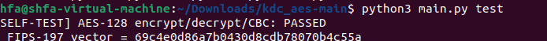
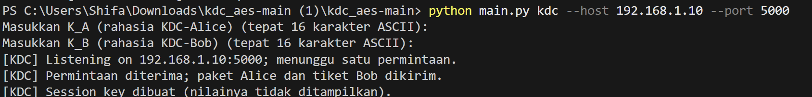
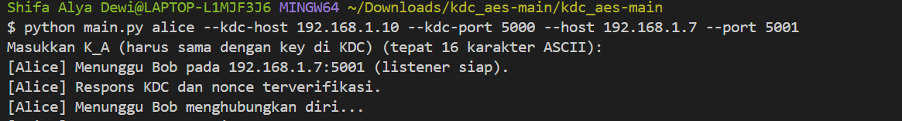
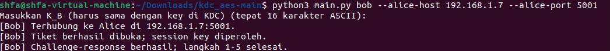
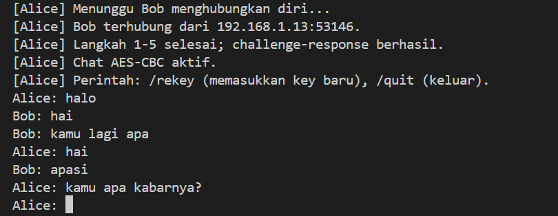
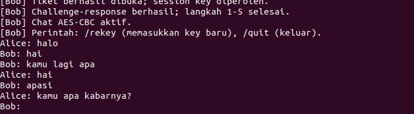
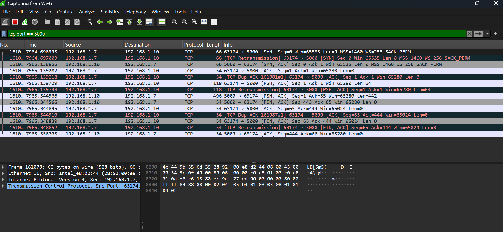
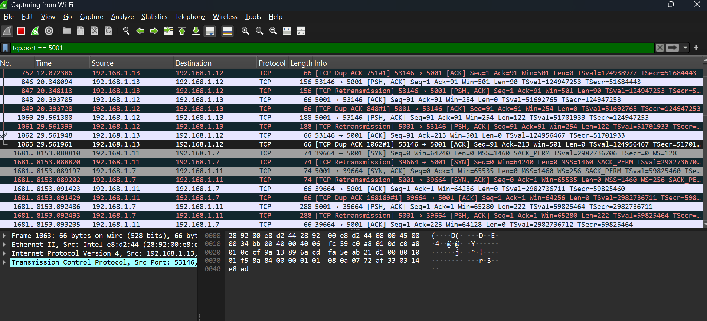
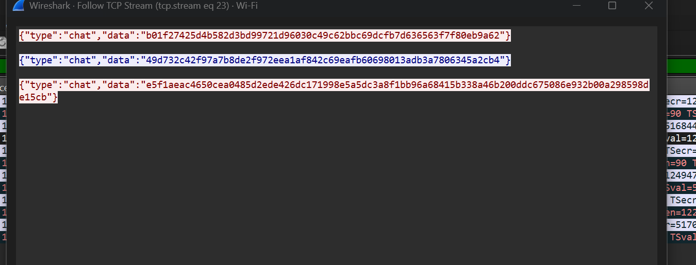

# IMPLEMENTASI KEY DISTRIBUTION CENTER (KDC) DAN AES-128 MANUAL

## Identitas Kelompok

| No | Name | NRP |
| -- | ---  | --- |
| 1 | Shifa Alya Dewi | 5025241176 |
| 2 | Dyah Utami Kesuma Dewi | 5025241186 |

---

## 1. Deskripsi Proyek

Proyek ini merupakan implementasi sistem distribusi kunci menggunakan **Key Distribution Center (KDC)** dan algoritma **Advanced Encryption Standard (AES)** sebagai bagian dari tugas praktikum mata kuliah Keamanan Informasi.

Sistem melibatkan tiga entitas utama, yaitu KDC, Alice, dan Bob. KDC berperan dalam distribusi session key, sedangkan Alice dan Bob menggunakan session key tersebut untuk membangun komunikasi terenkripsi. Implementasi dikembangkan menggunakan Python dengan komunikasi jaringan berbasis TCP socket dan algoritma AES yang diimplementasikan secara manual.

Proyek ini juga mencakup pengujian enkripsi dan dekripsi, validasi key, komunikasi pesan dua arah, serta pengamatan pertukaran data menggunakan Wireshark.

### Tujuan Proyek

- Mengimplementasikan skenario distribusi kunci yang melibatkan KDC, Alice, dan Bob.
- Memahami penerapan AES-128 melalui implementasi manual.
- Membangun komunikasi dua arah antara Alice dan Bob menggunakan session key.
- Menggunakan key dan plaintext berbasis ASCII serta menampilkan ciphertext dalam format hexadecimal (Hex).
- Menguji komunikasi antarentitas melalui jaringan dengan alamat IP berbeda.
- Mendokumentasikan proses pengembangan, pengujian, dan kontribusi anggota menggunakan Git dan GitHub.

---

## 2. Arsitektur Sistem

Sistem dibangun menggunakan tiga entitas dengan tanggung jawab yang berbeda.

| Entitas | Tanggung Jawab |
|---|---|
| **KDC** | Mengelola proses distribusi session key berdasarkan protokol yang diimplementasikan. |
| **Alice** | Mengajukan permintaan kepada KDC, memproses informasi distribusi kunci, dan menjadi endpoint server chat. |
| **Bob** | Memproses informasi atau tiket distribusi kunci, melakukan verifikasi sesuai protokol, dan menghubungi Alice untuk memulai komunikasi. |

### Topologi Pengujian

Implementasi pengujian menggunakan dua laptop dan satu lingkungan Ubuntu VM.

| Perangkat | Entitas | Port |
|---|---|---|
| Laptop 1 — Windows | KDC | TCP 5000 |
| Laptop 2 — Windows | Alice | TCP 5001 |
| Ubuntu VM | Bob | Klien Alice |

Setiap entitas harus menggunakan alamat IP aktual yang berbeda dan dapat saling dijangkau melalui jaringan yang digunakan. Alamat IP tidak ditetapkan secara permanen dalam dokumentasi karena dapat berubah sesuai konfigurasi jaringan.

### Alur Komunikasi

1. Alice mengirimkan permintaan distribusi session key kepada KDC.
2. KDC memproses permintaan dan menyiapkan informasi distribusi kunci.
3. Alice menerima serta memproses respons dari KDC.
4. Alice dan Bob menjalankan proses pertukaran informasi dan verifikasi sesuai protokol.
5. Setelah proses berhasil, Alice dan Bob dapat bertukar pesan menggunakan session key.

Urutan pesan dan mekanisme verifikasi mengikuti skenario yang diterapkan dalam kode serta materi perkuliahan.

---

## 3. Teknologi yang Digunakan

| Teknologi | Penggunaan |
|---|---|
| Python 3 | Bahasa pemrograman utama |
| TCP Socket | Komunikasi jaringan antare ntitas |
| AES-128 Manual | Enkripsi dan dekripsi pesan |
| ASCII | Representasi key dan plaintext |
| Hexadecimal | Representasi ciphertext |
| `unittest` | Pengujian otomatis |
| Wireshark | Analisis paket jaringan |
| Git & GitHub | Version control dan kolaborasi |

---

## 4. Struktur Repository

```text
kdc_aes/
├── .gitignore
├── main.py
├── kdc.py
├── alice.py
├── bob.py
├── chat.py
├── aes/
├── utils/
├── tests/
└── README.md
```

| File/Folder | Deskripsi |
|---|---|
| `main.py` | Entry point untuk menjalankan program berdasarkan peran. |
| `kdc.py` | Implementasi layanan Key Distribution Center. |
| `alice.py` | Implementasi Alice dan interaksinya dengan KDC. |
| `bob.py` | Implementasi proses Bob dalam distribusi kunci dan komunikasi. |
| `chat.py` | Pengelolaan pertukaran pesan Alice dan Bob. |
| `aes/` | Modul implementasi algoritma AES manual. |
| `utils/` | Fungsi pendukung encoding, validasi key, dan jaringan. |
| `tests/` | Pengujian otomatis AES dan encoding. |

**Catatan:** pastikan nama folder pengujian sesuai dengan repository. Jika folder yang tersedia bernama `test/`, gunakan nama tersebut pada struktur dan perintah pengujian.

---

## 5. Implementasi AES-128 Manual

AES-128 merupakan algoritma kriptografi simetris yang menggunakan key sepanjang 128 bit atau 16 byte. Pada proyek ini, proses inti AES diimplementasikan secara manual untuk memahami tahapan enkripsi dan dekripsi tanpa menyerahkan proses inti kepada fungsi AES siap pakai dari library kriptografi.

Komponen algoritma yang relevan meliputi:

- **Key Expansion:** menghasilkan round key dari key utama.
- **SubBytes:** melakukan substitusi byte melalui S-Box.
- **ShiftRows:** melakukan pergeseran baris pada state.
- **MixColumns:** melakukan transformasi pada kolom state.
- **AddRoundKey:** menggabungkan state dengan round key menggunakan XOR.
- **Inverse Transformations:** transformasi invers untuk proses dekripsi.

Komponen tersebut perlu disesuaikan dengan implementasi aktual pada folder `aes/`.

### Format Data

| Komponen | Format |
|---|---|
| Key | ASCII, 16 karakter untuk AES-128 |
| Plaintext | Teks ASCII |
| Ciphertext | Hexadecimal (Hex) |

Contoh representasi keluaran:

```text
Plaintext  : Halo Bob
Ciphertext : [Ciphertext Hex hasil program]
```

Ciphertext aktual bergantung pada key, mode operasi, IV, padding, dan plaintext yang digunakan. Oleh karena itu, contoh di atas hanya menunjukkan format keluaran, bukan hasil enkripsi tertentu.

---

## 6. Instalasi dan Persiapan

Pastikan Python 3 telah terpasang pada setiap perangkat yang menjalankan program.

### Windows

Buka Command Prompt dan periksa versi Python:

```cmd
python --version
```

### Ubuntu

Buka terminal dan jalankan:

```bash
python3 --version
```

### Mengambil Repository

Jika repository belum tersedia pada perangkat:

```bash
git clone [URL_REPOSITORY]
cd kdc_aes
```

Jika proyek sudah tersedia:

```bash
cd kdc_aes
git pull
```

Pastikan perubahan lokal telah disimpan atau di-commit sebelum melakukan `git pull`.

---

## 7. Konfigurasi Jaringan

KDC, Alice, dan Bob harus dapat saling menjangkau sesuai alur protokol. Untuk pengujian lintas perangkat, pastikan setiap entitas menggunakan IP aktual yang berbeda.

Periksa IP pada Windows menggunakan:

```cmd
ipconfig
```

Periksa IP pada Ubuntu menggunakan:

```bash
ip -4 addr
```

Contoh format alamat IP:

| Entitas | Alamat IP |
|---|---|
| KDC | `[IP_KDC]` |
| Alice | `[IP_ALICE]` |
| Bob | `[IP_BOB]` |

Ganti placeholder dengan IP yang benar-benar digunakan ketika pengujian.

### Persyaratan Konektivitas

- Ketiga entitas menggunakan alamat IP yang berbeda.
- Alice dapat menjangkau KDC pada TCP port 5000.
- Bob dapat menjangkau Alice pada TCP port 5001.
- Firewall mengizinkan koneksi pada port yang diperlukan.
- Konfigurasi VMware memungkinkan Ubuntu VM mengakses jaringan tujuan.

---

## 8. Cara Menjalankan Program

Jalankan setiap entitas pada terminal atau perangkat yang sesuai.

### A. KDC — Windows Laptop 1

Buka Command Prompt, lalu masuk ke folder proyek:

```cmd
cd path\ke\kdc_aes
```

Jalankan KDC:

```cmd
python main.py kdc --host [IP_KDC] --port 5000
```

Ganti `[IP_KDC]` dengan IP aktual KDC. Masukkan key sesuai permintaan program.

### B. Alice — Windows Laptop 2

Buka Command Prompt pada Laptop 2:

```cmd
cd path\ke\kdc_aes
```

Jalankan Alice:

```cmd
python main.py alice --kdc-host [IP_KDC] --kdc-port 5000 --host [IP_ALICE] --port 5001
```

Keterangan:

- `--kdc-host`: alamat IP KDC.
- `--kdc-port`: port layanan KDC.
- `--host`: alamat bind Alice yang didukung oleh program.
- `--port`: port server chat Alice.

Gunakan IP aktual dan pastikan alamat bind sesuai dengan interface jaringan Alice.

### C. Bob — Ubuntu VM

Buka terminal Ubuntu:

```bash
cd ~/kdc_aes
```

Jalankan Bob:

```bash
python3 main.py bob --alice-host [IP_ALICE] --alice-port 5001
```

Ganti `[IP_ALICE]` dengan IP aktual Alice yang dapat dijangkau dari Ubuntu VM.

### Urutan Eksekusi

1. Jalankan KDC.
2. Jalankan Alice.
3. Jalankan Bob.
4. Pastikan distribusi kunci dan verifikasi berhasil.
5. Uji komunikasi pesan dari Alice ke Bob.
6. Uji balasan dari Bob ke Alice.

**Penting:** perintah di atas harus disesuaikan jika argumen CLI pada versi kode aktual berbeda. Periksa dengan `python main.py --help` di Windows atau `python3 main.py --help` di Ubuntu.

---

## 9. Pengujian

Pengujian dilakukan untuk memverifikasi fungsi AES, distribusi session key, validasi key, dan komunikasi jaringan.

### Pengujian AES

```bash
python3 main.py test
```

### Pengujian Otomatis

Jika folder pengujian bernama `tests/`:

```bash
python3 -m unittest discover -s tests -v
```

Jika folder pengujian masih bernama `test/`:

```bash
python3 -m unittest discover -s test -v
```

### Skenario Pengujian

| No. | Skenario | Kriteria Keberhasilan |
|---|---|---|
| 1 | AES test vector | Hasil enkripsi cocok dengan test vector standar. |
| 2 | Enkripsi dan dekripsi | Plaintext dapat dipulihkan dengan key yang benar. |
| 3 | Distribusi session key | Alice dan Bob memperoleh session key yang sesuai. |
| 4 | Key salah | Program menolak proses dengan penanganan error yang jelas. |
| 5 | Alice mengirim pesan | Bob menerima pesan dengan benar. |
| 6 | Bob membalas pesan | Alice menerima balasan dengan benar. |
| 7 | Format ciphertext | Ciphertext ditampilkan dalam format Hex. |
| 8 | Pengujian jaringan | Komunikasi berhasil menggunakan IP aktual yang berbeda. |

Catat hasil aktual setiap pengujian. Status berhasil hanya diberikan setelah skenario benar-benar dijalankan dan diverifikasi.

---

## 10. Dokumentasi Wireshark

Wireshark digunakan untuk mengamati komunikasi jaringan yang berlangsung antara entitas.

### Display Filter

```text
tcp.port == 5000 || tcp.port == 5001
```

### Bukti yang Dikumpulkan

1. Paket komunikasi Alice dengan KDC.
2. Paket komunikasi Alice dengan Bob.
3. Alamat IP sumber dan tujuan.
4. Payload ciphertext dalam format Hex.
5. Bukti komunikasi dua arah.
6. Interface capture dan filter yang digunakan.

Gunakan interface jaringan yang sesuai. Jika komunikasi melewati VMware atau NAT, tampilan paket dapat berbeda antara interface fisik dan interface virtual.

---


## Dokumentasi Implementasi dan Pengujian

Bagian ini menyajikan dokumentasi hasil implementasi sistem Key Distribution Center (KDC) dan AES-128 Manual. Pengujian dilakukan menggunakan tiga entitas pada alamat IP berbeda untuk memverifikasi proses distribusi kunci, enkripsi dan dekripsi, komunikasi dua arah, serta pertukaran paket melalui jaringan.

### 1. Konfigurasi Lingkungan Pengujian

Pengujian sistem dilakukan menggunakan dua laptop Windows dan satu Ubuntu Virtual Machine (VM). Setiap entitas dijalankan pada alamat IP yang berbeda untuk mengimplementasikan komunikasi jaringan antara KDC, Alice, dan Bob.

| Entitas | Perangkat | IP Address | Port |
|---|---|---|---|
| KDC | Windows Laptop 1 | `192.168.1.10` | `5000` |
| Alice | Windows Laptop 2 | `192.168.1.7` | `5001` |
| Bob | Ubuntu Virtual Machine | `192.168.1.11` | Client |

Ketiga perangkat menggunakan jaringan lokal dengan subnet `192.168.1.0/24`. Konfigurasi tersebut digunakan untuk menguji distribusi session key dan komunikasi terenkripsi antara Alice dan Bob.

### 2. Pengujian Algoritma AES-128

Pengujian algoritma AES-128 dilakukan untuk memverifikasi bahwa proses enkripsi dan dekripsi menghasilkan keluaran yang sesuai dengan skenario pengujian.



*Gambar 1. Hasil pengujian implementasi AES-128 manual.*

**Hasil pengujian:** [Isi berdasarkan output pengujian aktual, misalnya jumlah test yang berhasil dan gagal.]

### 3. Pengujian Key Distribution Center (KDC)

KDC dijalankan sebagai layanan distribusi session key yang digunakan dalam proses komunikasi Alice dan Bob.



*Gambar 2. Proses menjalankan KDC pada alamat IP 192.168.1.10 dan port 5000.*

Hasil Pengujian: Server KDC berhasil dijalankan pada 192.168.1.10:5000 dan berada dalam kondisi menunggu permintaan dari Alice.

### 4. Pengujian Distribusi Session Key

#### 4.1 Proses Alice

Alice menghubungi KDC untuk melakukan proses distribusi session key sesuai protokol yang diimplementasikan.



*Gambar 3. Proses Alice melakukan komunikasi dengan KDC.*

Hasil Pengujian: Alice berhasil memverifikasi respons KDC, menerima koneksi Bob dari 192.168.1.13, dan menyelesaikan langkah 1–5 protokol. Setelah autentikasi berhasil, komunikasi menggunakan AES-CBC dinyatakan aktif oleh program.

#### 4.2 Proses Bob

Bob menerima dan memproses informasi yang diperlukan untuk membangun komunikasi terenkripsi dengan Alice.



*Gambar 4. Proses Bob melakukan koneksi dan verifikasi sesuai protokol.*

Hasil Pengujian: Bob berhasil terhubung ke Alice, memperoleh session key dari tiket, dan menyelesaikan langkah 1–5 protokol. Program kemudian mengaktifkan sesi komunikasi AES-CBC.

### 5. Pengujian Komunikasi Terenkripsi Dua Arah

Pengujian dilakukan untuk memastikan Alice dan Bob dapat saling mengirim serta menerima pesan menggunakan session key yang telah didistribusikan.

#### 5.1 Komunikasi pada Sisi Alice



*Gambar 5. Pengiriman pesan dan penerimaan balasan pada terminal Alice.*

#### 5.2 Komunikasi pada Sisi Bob



*Gambar 6. Penerimaan pesan dan pengiriman balasan pada terminal Bob.*

Hasil Pengujian: Alice dan Bob berhasil bertukar pesan secara bergantian. Pesan dari Alice dapat diterima oleh Bob, dan sebaliknya, Bob dapat mengirimkan pesan yang diterima Alice. Hasil ini menunjukkan bahwa fungsi komunikasi dua arah pada aplikasi berjalan sesuai skenario pengujian.

### 6. Analisis Paket Jaringan Menggunakan Wireshark

Pengamatan paket dilakukan menggunakan Wireshark untuk memeriksa komunikasi antarpihak, alamat IP sumber dan tujuan, serta data yang dikirim melalui TCP.

#### 6.1 Komunikasi KDC dan Alice

Display filter:

```text
tcp.port == 5000
```



*Gambar 7. Capture komunikasi TCP antara KDC dan Alice pada port 5000.*

Hasil Pengamatan: Capture menunjukkan proses pembentukan koneksi TCP, pertukaran data aplikasi, dan penutupan koneksi antara Alice dan KDC. Paket diamati menggunakan display filter tcp.port == 5000.
#### 6.2 Komunikasi Alice dan Bob

Display filter:

```text
tcp.port == 5001
```



*Gambar 8. Capture komunikasi TCP antara Alice dan Bob pada port 5001.*

Capture menunjukkan pertukaran paket TCP antara Alice (192.168.1.7) dan Bob (192.168.1.11) selama komunikasi pesan berlangsung. Port 5001 digunakan oleh Alice sebagai port layanan, sedangkan Bob menggunakan port sementara untuk koneksi TCP.

#### 6.3 Analisis Payload Ciphertext



*Gambar 9. Representasi data aplikasi pada paket komunikasi terenkripsi.*

Hasil analisis: Hasil pengamatan menunjukkan bahwa pesan chat dikirim dalam format JSON dengan atribut type dan data. Atribut data berisi rangkaian karakter hexadecimal yang merepresentasikan data terenkripsi, bukan plaintext pesan yang dapat dibaca langsung. Pengamatan ini mendukung bahwa aplikasi mengirimkan ciphertext dalam format hexadecimal melalui komunikasi TCP.

### 7. Kesimpulan Pengujian

Berdasarkan hasil pengujian, implementasi AES-128 manual berhasil melewati pengujian self-test untuk proses enkripsi, dekripsi, dan mode CBC, serta menghasilkan keluaran yang sesuai dengan test vector FIPS-197. Proses distribusi session key melalui KDC dan autentikasi Alice–Bob juga berhasil dijalankan sesuai alur protokol yang diimplementasikan, sebagaimana ditunjukkan oleh keberhasilan verifikasi respons KDC, pembukaan tiket, dan proses challenge-response. Pengujian komunikasi menunjukkan bahwa Alice dan Bob dapat bertukar pesan secara dua arah setelah sesi AES-CBC diaktifkan.

Hasil pengamatan menggunakan Wireshark menunjukkan adanya pertukaran paket TCP antara KDC dan Alice pada port 5000, serta antara Alice dan Bob pada port 5001. Pemeriksaan melalui fitur Follow TCP Stream memperlihatkan payload chat dalam format JSON, dengan nilai data direpresentasikan sebagai rangkaian karakter hexadecimal yang diidentifikasi oleh implementasi sebagai ciphertext. Hasil ini mendukung bahwa fungsi utama sistem berjalan sesuai skenario pengujian, meskipun pengamatan format payload saja belum cukup untuk membuktikan keamanan kriptografis secara menyeluruh.

Pengujian ini menunjukkan bahwa implementasi telah memenuhi fungsi dasar distribusi kunci dan komunikasi terenkripsi sesuai ruang lingkup tugas. Namun, aspek seperti ketahanan terhadap manipulasi pesan, validasi integritas ciphertext, dan keamanan pengelolaan kunci masih perlu dievaluasi lebih lanjut sebelum sistem dapat dianggap aman untuk penggunaan di luar lingkungan pembelajaran.uk mengevaluasi kesesuaian implementasi terhadap kebutuhan tugas dan mengidentifikasi keterbatasan sistem yang masih perlu diperhatikan.


## 11. Pembagian Tugas Kelompok

### Anggota 1 — KDC dan Protokol Distribusi Kunci

Tanggung jawab utama:

- Mengembangkan dan memelihara `kdc.py`.
- Mengimplementasikan proses distribusi kunci pada `alice.py`.
- Menangani permintaan dan respons KDC.
- Menguji penggunaan key dan penanganan key salah.
- Mendokumentasikan alur protokol sesuai materi perkuliahan.

### Anggota 2 — AES Manual dan Komunikasi

Tanggung jawab utama:

- Mengimplementasikan AES manual pada folder `aes/`.
- Mengembangkan fungsi encoding dan validasi pada folder `utils/`.
- Mengembangkan komunikasi pada `chat.py` dan `bob.py`.
- Membuat dan menjalankan pengujian otomatis.
- Mendokumentasikan hasil pengujian dan Wireshark.

### Pekerjaan Bersama

- Integrasi seluruh modul.
- Pengujian end-to-end.
- Pengujian menggunakan tiga IP berbeda.
- Penyusunan README dan dokumentasi.
- Persiapan demonstrasi dan presentasi.
- 
---

# Cara Run versi Dyah

1. Download semua file, yg kuubah si cuman nama folder test jadi tests, file main.py, file alice.py, bob.py, kdc.py, sama chat.py.
2. Buka CDM (Command Prompt) di laptop 1 trus cek ip nya pake ipconfig
3. Trus buka folder tugasnya
4. trus jalanin command buat kdc ini `python main.py kdc --host 192.168.1.2 --port 5000` ip nya sesuaikan
5. trus buka cdm di laptop 2, cek ip jg pake ipconfig
6. Trus buka folder, trus command buat alice yg ini `python main.py alice --kdc-host 192.168.1.2 --kdc-port 5000 --host 192.168.1.8 --port 5001` ip jangan lupa disesuaikan
7. trus lanjut ke terminal vm, mirip caranya cuman skrg command buat bob `python3 main.py bob --alice-host 192.168.1.8 --alice-port 5001` jangan lupa disesuaikan ip jg pake ip a ya di vm 
8. dah si skrg dah bisa chatan itu Bob sm Alice
9. ok bye dunia ak ngantok
10. good luck, jangan stres karena tugas kita dah oke mantap josjis

---

KDC + AES Manual (Tugas Keamanan Informasi)

Implementasi pembelajaran dengan:
- KDC, Alice, dan Bob sebagai tiga proses terpisah.
- AES-128 manual (bukan library AES siap pakai).
- Distribusi session key mengikuti pola lima langkah: Alice meminta key; KDC mengirim paket untuk Alice dan tiket Bob; Alice meneruskan tiket; Bob mengirim nonce; Alice mengembalikan nonce+1.
- Plaintext dan key dibatasi ke ASCII. Ciphertext ditampilkan/dikirim sebagai Hex.
- TCP dengan framing newline JSON.
- Test terpisah untuk AES dan fungsi encoding.

> Penting: cocokkan format pesan dan detail langkah 1–5 dengan PPT dosen. Implementasi ini memakai asumsi protokol yang dijelaskan di README; jika PPT berbeda, protokol harus disesuaikan.
> CBC tidak memberi autentikasi integritas. Ini proyek pembelajaran, bukan protokol untuk produksi.

## 1. Prasyarat
Python 3.10+ (tidak perlu menginstal library pihak ketiga).

## 2. Jalankan tes
```bash
python -m unittest discover -s tests -v
```

## 3. Pengujian awal pada satu laptop
Gunakan `127.0.0.1` untuk tes lokal. Buka tiga terminal di folder proyek.

Terminal 1 (kdc):
```
python main.py kdc --host 192.168.1.2 --port 5000
```
Masukkan key ASCII 16 karakter saat diminta, misalnya `AliceKey12345678` dan `BobKey1234567890`.

Terminal 2 (alice):
```
python main.py alice --kdc-host 192.168.1.2 --kdc-port 5000 --host 192.168.1.8 --port 5001
```
Masukkan K_A yang sama persis dengan KDC.

Terminal 3 (bob) (vm):
```
python3 main.py bob --alice-host 192.168.1.8 --alice-port 5001
```
Masukkan K_B yang sama persis dengan KDC.

Urutan: jalankan KDC, lalu Alice, lalu Bob. Setelah chat dimulai, ketik pesan di prompt `> `. Ketik `/rekey`, lalu masukkan key ASCII baru 16 karakter untuk memulai rotasi session key; tunggu konfirmasi sebelum mengirim pesan lagi. Ketik `/quit` untuk keluar.

## 4. Tiga perangkat
Cari IPv4 setiap perangkat dengan `ipconfig` (Windows) atau `ip addr` (Linux). Contoh alamat di bawah hanya ilustrasi:
- KDC: `192.168.1.10`
- Alice: `192.168.1.11`
- Bob: `192.168.1.12`

Terminal KDC:
```bash
python main.py kdc --host 0.0.0.0 --port 5000
```
KDC bind ke semua interface; Alice memakai IP LAN KDC untuk menghubunginya.

Terminal Alice:
```
python main.py alice --kdc-host 192.168.1.10 --kdc-port 5000 --host 0.0.0.0 --port 5001
```
Alice bind ke semua interface agar Bob bisa masuk. Gunakan IP LAN Alice sebagai tujuan Bob.

Terminal Bob:
```
python main.py bob --alice-host 192.168.1.11 --alice-port 5001
```
Sesuaikan IP aktual. Izinkan koneksi TCP pada port 5000 dan 5001 di firewall. Pastikan ketiga perangkat berada pada jaringan yang saling terjangkau.

## 5. Wireshark
Display filter:
```text
tcp.port == 5000 || tcp.port == 5001
```
Port 5000 adalah Alice–KDC; port 5001 adalah Alice–Bob. Payload JSON dan metadata masih terlihat, sedangkan paket yang dienkripsi muncul sebagai Hex.

## Batasan yang perlu dijelaskan
- KDC hanya melayani satu permintaan distribusi per proses; jalankan ulang KDC untuk sesi baru.
- AES-CBC tidak mengautentikasi ciphertext. Untuk keamanan nyata perlu MAC/AEAD dan protokol yang ditinjau ahli.
- Key yang dimasukkan harus 16 karakter ASCII (AES-128). Jangan menggunakan key contoh pada jaringan nyata.
- `/rekey` menyediakan pertukaran key dasar untuk demo. Ini protokol pembelajaran dan tidak aman untuk penggunaan produksi karena CBC tidak memberi autentikasi integritas; jika dosen meminta jaminan keamanan kuat, gunakan protokol yang diajarkan di kelas dan autentikasi pesan.
